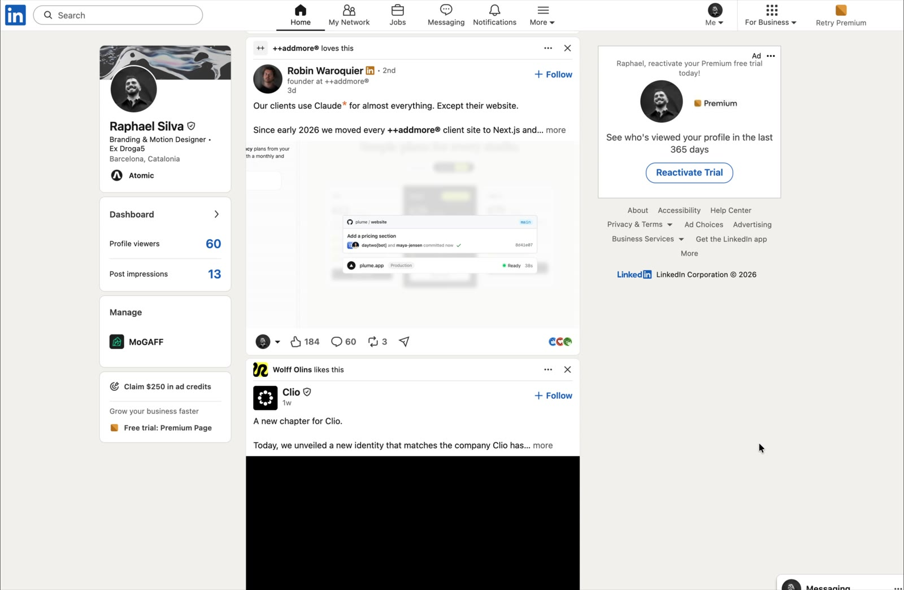

Chrome extension · v1.1

<h3 align="center">Marks AI tools on any web page and shows what’s behind them.</h3>

<b>*</b> Free and open source &nbsp; <b>*</b> Sends nothing about you 
<b>*</b> Updates itself &nbsp; <b>*</b> Chrome, Edge, Brave, Arc

<a href="https://sayhellotosilva.github.io/disclaimer-extension/download/disclaimer-extension.zip"><b>Download for Chrome</b></a> · <a href="https://sayhellotosilva.github.io/disclaimer-extension/">Website</a> · <a href="#español">Español</a>

 
disclaimer on a social media post. Every name with an asterisk opens a card. <a href="https://sayhellotosilva.github.io/disclaimer-extension/">Watch the demo ↗</a>

## Why

**AI is designed to feel weightless: a text box, an answer, nothing else.**

Behind every prompt there is a building on farmland, a river cooling it, minerals mined in Congo and China, people in Nairobi and Manila labelling data, and a company lobbying the people who write the rules. None of it shows up in the interface.

## What a card shows

| | Section | What it shows |
|---|---|---|
| 01 | **Where it lives** | The data centres and chips it runs on. |
| 02 | **What it’s made of** | The minerals in those chips, and where they’re mined. |
| 03 | **Who trains it** | The workers and outsourcing firms behind it. |
| 04 | **Environment** | Energy, water and emissions. |
| 05 | **Terms and conditions** | Your data, and what you can switch off. |
| 06 | **Politics** | What it spends lobbying the EU. |
| 07 | **disclaimer** | Its biggest documented controversy. Always open. |

Works for any AI tool, today’s and the ones still to come. Model names lead to their maker: “Opus 5.5” opens Claude, “GPT-5” opens ChatGPT.

## Install in two minutes

1. [Download the zip](https://sayhellotosilva.github.io/disclaimer-extension/download/disclaimer-extension.zip) and unzip it.
2. In Chrome, go to `chrome://extensions`.
3. Turn on **Developer mode**, top right.
4. Click **Load unpacked** and choose the `disclaimer-extension` folder.
5. Pin the orange asterisk, then open any page that talks about AI.

Chrome may sometimes remind you that a developer-mode extension is installed. That’s normal.

## Sources

Every fact links to where it comes from: research, official data, established press and the EU Transparency Register. Each one carries a label:

- **sourced**: research, official data or established press
- **company says**: the company’s own claim, from its own documents
- **estimate**: a calculation or approximation

Found something wrong or out of date? [Open an issue](https://github.com/sayhellotosilva/disclaimer-extension/issues).

## Privacy

disclaimer reads the text of the pages you visit on your own computer, only to find AI names. It never sends that text, or anything about you, anywhere: no server, no account, no tracking.

## How it stays up to date

The only thing disclaimer downloads is the public card data, from this project’s GitHub Pages site, when Chrome starts and every 6 hours. It’s the same file for everyone and carries nothing about you or the pages you read.

- The cards are written in [`extension/data.js`](extension/data.js). When it changes, a GitHub Action rebuilds [`docs/data/cards.json`](docs/data/cards.json) and every installed copy picks it up, without reinstalling. **Check now** in the toolbar popup gets it immediately.
- If the download fails, disclaimer keeps the last good copy, or the copy built into the extension.
- Downloaded text is cleaned before it’s shown: only simple formatting and https links are kept, so the online file can never run code on the pages you visit.
- To correct a fact, edit `extension/data.js` or open an issue. To rebuild by hand: `node scripts/build-data.mjs`.

---

Made by [Raphael Silva](https://www.linkedin.com/in/raphaelllsilva) · Barcelona, 2026

Code: [MIT](LICENSE). Texts and data: [CC BY 4.0](LICENSE-DATA.md).

---

## Español

**Marca las herramientas de IA en cualquier página web y muestra lo que hay detrás.** Gratis y de código abierto. No envía nada sobre ti. Se actualiza sola.

### Instalación

1. [Descarga el zip](https://sayhellotosilva.github.io/disclaimer-extension/download/disclaimer-extension.zip) y descomprímelo.
2. En Chrome, ve a `chrome://extensions`.
3. Activa el **Modo de desarrollador**, arriba a la derecha.
4. Haz clic en **Cargar extensión sin empaquetar** y elige la carpeta `disclaimer-extension`.
5. Fija el asterisco naranja y abre cualquier página que hable de IA.

### Privacidad

disclaimer lee el texto de las páginas en tu propio ordenador. Nunca envía ese texto ni nada sobre ti: sin servidor, sin cuenta, sin rastreo. Cada dato enlaza a su fuente.
