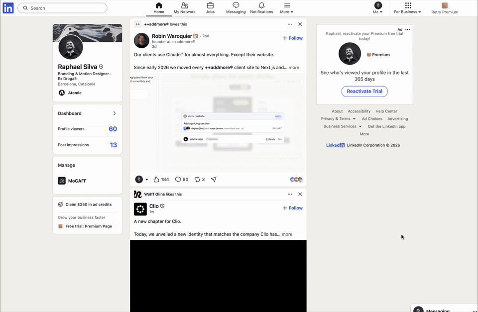

<b>The disclaimer AI companies don’t write.</b> 
A Chrome extension that marks AI tools on any web page and shows what’s behind them.

<a href="https://github.com/sayhellotosilva/disclaimer-extension/releases/latest/download/disclaimer-extension.zip"><b>Download</b></a> · <a href="https://sayhellotosilva.github.io/disclaimer-extension/">Website</a> · <a href="#español">Español</a>

## What it does

AI is designed to feel weightless: a text box, an answer, nothing else. disclaimer puts the weight back.

When a page mentions an AI tool (ChatGPT, GPT-5, Claude, Opus 5.5, Gemini, Copilot, Meta AI, Grok, DeepSeek, Perplexity, Le Chat, Midjourney, Figma Weave…), the name gets a small orange asterisk, like a footnote. Hover over it (or tap it) to open a card:

| Section | What it shows |
|---|---|
| **Where it lives** | The data centres and chips it runs on |
| **What it’s made of** | The minerals in those chips, and where they’re mined |
| **Who trains it** | The workers and outsourcing firms behind it |
| **Environment** | Energy, water and emissions |
| **Terms and conditions** | What happens to *your* data, and what you can switch off |
| **Politics** | EU lobbying spend, from the EU Transparency Register |
| **disclaimer** | The biggest documented controversy |

Model names lead to their maker: “Opus 5.5” opens Claude, “GPT-5” opens ChatGPT. Tools built on other companies’ models, like Figma Weave, list who your prompt actually goes to.

## Install (2 minutes)

1. [Download the zip](https://github.com/sayhellotosilva/disclaimer-extension/releases/latest/download/disclaimer-extension.zip) and unzip it.
2. In Chrome, go to `chrome://extensions`.
3. Turn on **Developer mode** (top right).
4. Click **Load unpacked** and choose the unzipped `disclaimer-extension` folder.
5. Pin the orange asterisk to your toolbar. Open any page that talks about AI.

Works in Chrome, Edge, Brave and Arc. Chrome may sometimes remind you that a developer-mode extension is installed; that’s normal.

## Privacy

disclaimer reads the text of the pages you visit **on your own computer** to find AI names. It never sends that text, or anything about you, anywhere: no server, no account, no tracking.

The only thing it downloads is the public card data (see below), from this project's GitHub Pages site, when Chrome starts and every 6 hours. That download is the same file for everyone and carries nothing about you or the pages you read.

## Always up to date

The cards are written in one file, [`extension/data.js`](extension/data.js). When it changes on GitHub, a GitHub Action rebuilds [`docs/data/cards.json`](docs/data/cards.json), GitHub Pages publishes it, and every installed copy of disclaimer picks it up within 6 hours, without reinstalling. Click **Check now** in the toolbar popup to get it immediately.

- If the download fails, disclaimer keeps the last good copy, or the copy built into the extension.
- Downloaded text is cleaned before it's shown: only simple formatting and https links are kept, so the online file can never run code on the pages you visit.
- To correct a fact, edit `extension/data.js` (or open an issue). To rebuild the file by hand: `node scripts/build-data.mjs`.

## Sources

Every fact on every card links to its source, and is labelled:

- **sourced**: research, official data or established press (e.g. TIME, AP, the Washington Post, Reuters, the US Geological Survey, the International Energy Agency, Epoch AI, the EU Transparency Register)
- **company says**: the company’s own claim, from its own documents
- **estimate**: a calculation or approximation

The date the card data was last updated is shown at the bottom of every card and in the toolbar popup. If something is wrong or out of date, please [open an issue](https://github.com/sayhellotosilva/disclaimer-extension/issues).

## Limits

- disclaimer is a curation. Choosing the categories and the facts is itself a classification; every choice is sourced so you can check it.
- Companies that publish more can look worse than companies that publish nothing. “Not disclosed” is a finding, not a clean record.
- Facts change. Data centres open, lawsuits end. The cards update online, but a person still has to check and edit each fact.
- It reads text only, not images or videos, and only in desktop browsers.

## About

Made by [Raphael Silva](https://www.linkedin.com/in/raphaelllsilva) for *A technical history of AI*, Master in Applied AI for Arts and Design, Elisava, Barcelona, 2026. Built with the help of AI (Claude), which has its own card in the extension.

Code: [MIT](LICENSE). Research texts and data: [CC BY 4.0](LICENSE-DATA.md).

---

## Español

**El disclaimer que las empresas de IA no escriben.** Una extensión de Chrome que marca las herramientas de IA en cualquier página web y muestra lo que hay detrás: centros de datos, minerales, trabajadores, medio ambiente, tus datos y política.

### Instalación

1. [Descarga el zip](https://github.com/sayhellotosilva/disclaimer-extension/releases/latest/download/disclaimer-extension.zip) y descomprímelo.
2. En Chrome, ve a `chrome://extensions`.
3. Activa el **Modo de desarrollador** (arriba a la derecha).
4. Haz clic en **Cargar extensión sin empaquetar** y elige la carpeta `disclaimer-extension`.
5. Fija el asterisco naranja en la barra. Abre cualquier página que hable de IA.

### Privacidad

disclaimer lee el texto de las páginas **en tu propio ordenador**. Nunca envía ese texto ni nada sobre ti: sin servidor, sin cuenta, sin rastreo. Lo único que descarga es la información pública de las tarjetas, desde GitHub, al abrir Chrome y cada 6 horas, para que las correcciones lleguen a todo el mundo sin reinstalar. Cada dato enlaza a su fuente.
